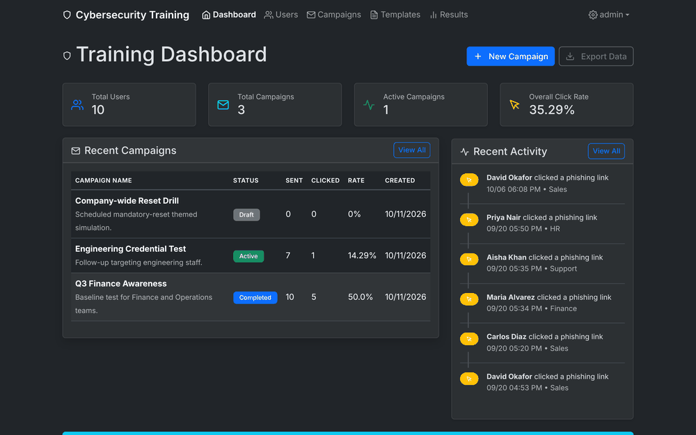
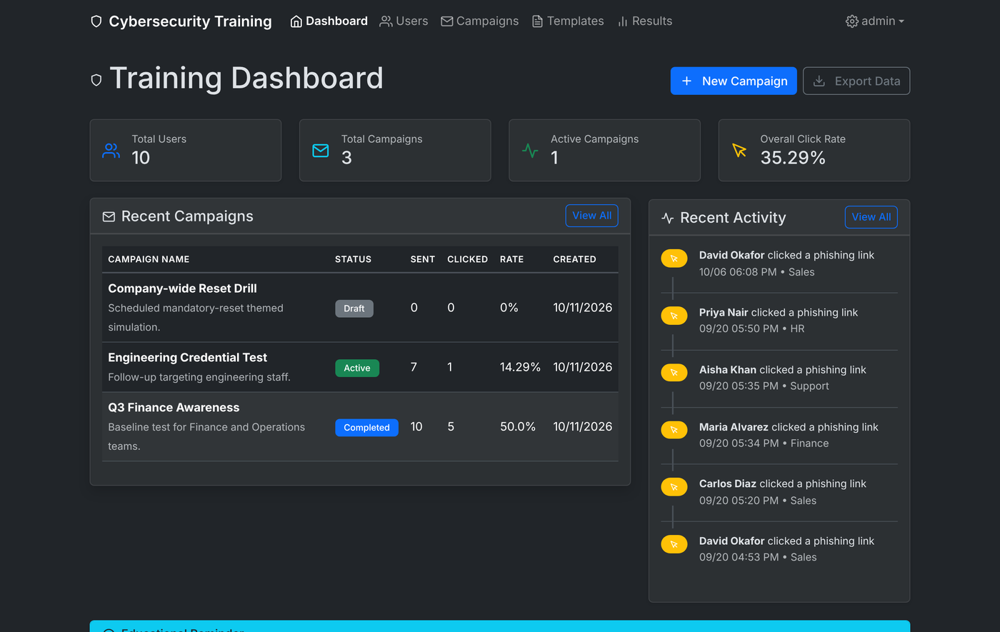
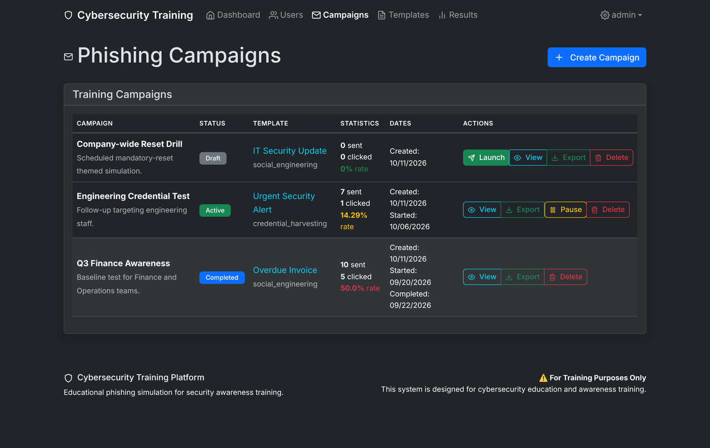
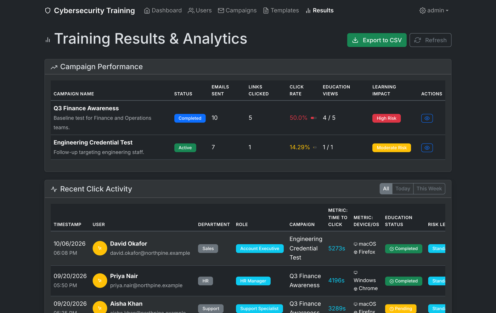
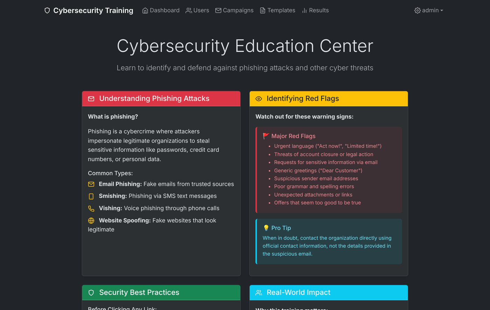

# PhishAwareAi (Phishing Trainer)

A self-hosted phishing **simulation and security-awareness training** platform built with Flask. It lets an administrator run simulated phishing campaigns against their own team, track who clicks, and automatically serve educational material to anyone who falls for a test, so people learn to recognize real attacks in a safe environment.

This is a defensive security-training tool, in the same category as open-source projects like [GoPhish](https://github.com/gophish/gophish). It is intended only for authorized awareness training. See [Responsible use](#responsible-use) below.



## Features

- **Campaign management:** create and send simulated phishing emails to a list of users
- **Click tracking:** records who opened a link, when, and from what browser and device (via user-agent parsing)
- **Education on failure:** users who click are shown a landing page that explains the red flags they missed
- **Results dashboard:** per-campaign and per-user reporting, with a risk rating per campaign
- **Multiple email backends:** Gmail/SMTP, [SendGrid](https://sendgrid.com), or [Resend](https://resend.com)
- **Optional AI personalization:** generate email variations with OpenAI (GPT-4o) when an API key is provided
- **Admin authentication:** Flask-Login with hashed passwords

## Screenshots

| Training dashboard | Phishing campaigns |
|---|---|
|  |  |

| Results and analytics | Education center |
|---|---|
|  |  |

> The data shown above is sample data generated for demonstration. All names and email addresses are fictional.

## Tech stack

- **Backend:** Python 3.11+, Flask, Flask-SQLAlchemy, Flask-Login
- **Database:** SQLite by default (set `DATABASE_URL` to use PostgreSQL/MySQL)
- **Email:** SMTP / SendGrid / Resend
- **Frontend:** server-rendered Jinja2 templates, vanilla JS, Bootstrap 5

## Getting started

### 1. Clone and install

```bash
git clone https://github.com/shaanb02/phishing-trainer.git
cd phishing-trainer
python -m venv .venv
source .venv/bin/activate        # Windows: .venv\Scripts\activate
pip install -r requirements.txt
```

### 2. Configure environment

Copy the example file and fill in your own values:

```bash
cp .env.example .env
```

At minimum set `SESSION_SECRET` (any long random string) and one email backend. See `.env.example` and `SETUP_INSTRUCTIONS.md` for details on getting a Gmail app password or a SendGrid/Resend API key.

### 3. Run

```bash
python main.py
```

The app starts at `http://localhost:5000`. The database tables are created automatically on first run. Open the app and create your first admin account via the setup page.

> **Note:** `main.py` runs Flask's development server with `debug=True`. For any real deployment, run behind a production WSGI server (for example `gunicorn`) with `debug=False`.

## Configuration reference

| Variable | Purpose |
|---|---|
| `SESSION_SECRET` | Flask session signing key (required) |
| `DATABASE_URL` | Database connection string (defaults to local SQLite) |
| `SMTP_SERVER` / `SMTP_PORT` / `SMTP_USERNAME` / `SMTP_PASSWORD` / `FROM_EMAIL` | SMTP email backend |
| `SENDGRID_API_KEY` | SendGrid backend (alternative to SMTP) |
| `RESEND_API_KEY` | Resend backend (alternative to SMTP) |
| `OPENAI_API_KEY` | Optional, enables AI email personalization |

## Responsible use

This software sends deceptive emails and collects interaction data. Use it **only** on people and systems you are explicitly authorized to test, such as employees of your own organization who have been enrolled in a security-awareness program.

- Do not use it to target anyone without authorization.
- Sending deceptive email to people without permission may be illegal in your jurisdiction.
- Follow applicable privacy laws when storing data about who clicked.

The author assumes no liability for misuse.

## Background

This platform is the implementation behind a research study on low-cost phishing-simulation tooling for cybersecurity awareness in educational settings, published in the National High School Journal of Science (NHSJS): [read the paper](https://nhsjs.com/2026/development-and-evaluation-of-a-low-cost-web-based-phishing-simulation-platform-for-cybersecurity-awareness-in-educational-settings/).

## License

Released under the [MIT License](LICENSE).
